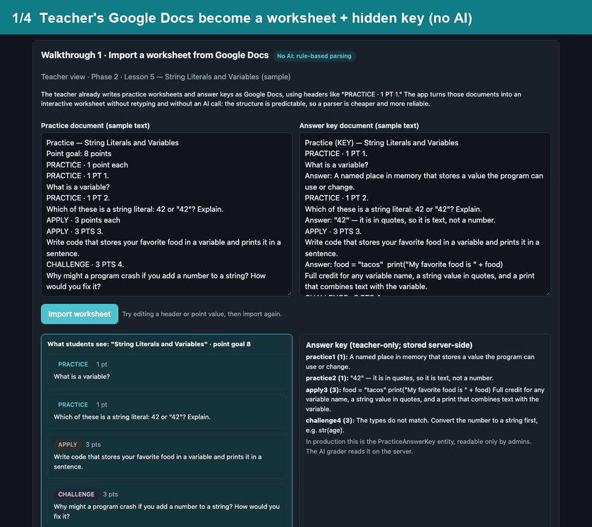

# Class Stream: a custom classroom app built for a fellow educator

Class Stream is a course app for a middle-school **computer science** class. It turns the teacher's existing Google Docs lesson materials into interactive notes, practice worksheets and quizzes. It adds AI-drafted formative assessments and AI scoring of practice work, with the teacher reviewing the results.

**Designed and built by Aspen Ham** (EAST facilitator) in [Base44](https://base44.com) with AI-assisted development, for a colleague's classroom.

> **In daily use with about 150 students.** The real app holds student work and grades, so it can't be shown publicly. This repository is a cleaned copy of the source code, plus a **separate demo with made-up lesson materials and students**, not connected to the real app, Google Drive, or any server.

**[Open the live demo](https://hamaeast.github.io/class-stream-ai-portfolio/)**: three short walkthroughs, fictional data, prerecorded AI responses, no sign-in.



> **How student and school data was protected:** No student records were copied. 92 Google Drive lesson-plan file IDs, the pacing-workbook link, a school-calendar image hosted under the app's Base44 storage, three database record IDs, and the school and district names were removed and replaced with settings. Every student and worksheet in the demo is made up. Details: [docs/public-copy-notes.md](docs/public-copy-notes.md).

Also see my own classroom app, the [EAST Dashboard](https://github.com/hamaeast/east-classroom-ai-portfolio).

---

## How it started

Class Stream began as a request for **one central place for the class**. Students needed to find lesson materials, keep track of deadlines, submit work, follow their progress, and know what to do next. The teacher needed to organize lessons and curriculum, assign work, and manage grading.

It started with that core and has since grown to include quizzes, guided notes, practice, vocabulary, pacing calendars, and teacher feedback. Each addition aimed to make classroom learning and management clearer and more organized.

## Who did what

- **The teacher** supplied the Google Drive course materials (lesson plans, guided notes, practice worksheets and answer keys, quizzes, and the pacing calendar) and explained how she wanted the class to run each day.
- **I** designed and built the Base44 app that organizes those materials into interactive learning activities and teacher tools. That includes deciding where AI is useful and where ordinary software logic is the better choice.
- **How it was built:** Base44 is an AI-assisted app builder. Most of the code was generated from my specifications and revision requests, and I tested and revised it. I did not write every line by hand.
- **Not claimed here:** measured learning outcomes, or a formal co-design process.

## Three walkthroughs

| | What happens | AI? |
|-|-|-|
| **1. Import a worksheet** | The teacher's practice doc and answer-key doc are parsed into an interactive worksheet. Students get the questions; the answer key is stored on the server where only the teacher can read it. | **No.** The documents follow a predictable format ("PRACTICE · 1 PT 1."), so a parser is cheaper and more reliable. |
| **2. Generate and edit a formative assessment** | AI drafts a study guide and 10 multiple-choice questions from the lessons in the selected phases. Code drops malformed questions and saves the draft **hidden from students**. The teacher edits it, then releases it. | **Yes**, to draft. The teacher decides. |
| **3. Review an AI-scored practice** | AI scores open answers against the teacher's model answers, with partial credit and a 6th-grade writing bar. It also reports its own confidence. Below 0.90 weighted confidence, the attempt goes to the teacher, who can adjust scores and approve. | **Yes**, to score. The teacher reviews uncertain cases. |

Imported materials and AI-generated materials are kept separate. **Lesson notes, practice worksheets, and lesson quizzes are parsed from the teacher's documents.** Formative assessments and the teacher's guided-notes answer key are drafted by AI.

## Features in the code

| Feature | What it shows |
|-|-|
| Imports Google Docs into interactive notes, practice, and quizzes ([`practiceParser.ts`](base44/shared/practiceParser.ts), [`buildLessonNotes`](base44/functions/buildLessonNotes/entry.ts), [`buildLessonQuiz`](base44/functions/buildLessonQuiz/entry.ts)) | Turning existing teaching resources into usable digital workflows |
| AI-drafted formative assessments and study guides from selected lessons ([`buildCfa`](base44/functions/buildCfa/entry.ts), [`CfaEditor.jsx`](src/components/CfaEditor.jsx)) | Connecting AI generation to the course's own lesson context |
| AI practice scoring against teacher model answers, with partial credit and a writing-level guideline ([`gradePractice.ts`](base44/shared/gradePractice.ts)) | Designing feedback around the teacher's expectations |
| Teacher review screen for flagged practice, with score adjustment and approval ([`ReviewPractices.jsx`](src/pages/ReviewPractices.jsx)) | Building human review into AI workflows |
| Cached lesson-plan pages, notes, and notes answer keys; regrading only when the answer key changes | Avoiding repeated processing and unnecessary AI calls |
| Editable practice questions and keys, student preview mode, and grade exports ([`PracticeEditor.jsx`](src/components/PracticeEditor.jsx), [`PreviewStudent.jsx`](src/pages/PreviewStudent.jsx), [`exportCompleteGradesCsv`](base44/functions/exportCompleteGradesCsv/entry.ts)) | Designing around practical teacher needs |

**Security review:** [docs/security-review.md](docs/security-review.md) lists what a review of grading and data access found. Students could write their own scores, answer keys were readable, and two records had no access rules. It also covers how this repository fixes each one. These fixes are in this public copy and have **not been deployed to the live classroom app**.

More detail: **[docs/ai-design.md](docs/ai-design.md)** covers each AI call, which protections the code enforces and which are only asked for in the prompt, and known gaps.

## Try the demo locally

```bash
cd demo && python3 -m http.server 8766
```

Open <http://127.0.0.1:8766>. The page's Content-Security-Policy sets `connect-src 'none'`, so the browser blocks every network request. The demo runs logic ported from production (the worksheet parser, grade finalizing, and assessment cleanup) in `demo/policy.js`, which has its own tests: `node --test demo/policy.test.mjs`.

## What runs locally vs. what needs Base44

| Part | Runs locally? |
|-|-|
| `demo/` and its tests | Yes, fully offline |
| Frontend lint and build (`npm ci && npm run lint && npm run build`) | Yes |
| The full app, backend functions, data with access rules, and AI calls | Needs a Base44 app, a Google Drive connection, and your own settings (see `.env.example`) |

## Checks

See [docs/checks.md](docs/checks.md).

## License

This repository is shared for viewing only. No open-source license is granted, so all rights are reserved. You're welcome to read the code and try the demo; please ask before reusing it.
